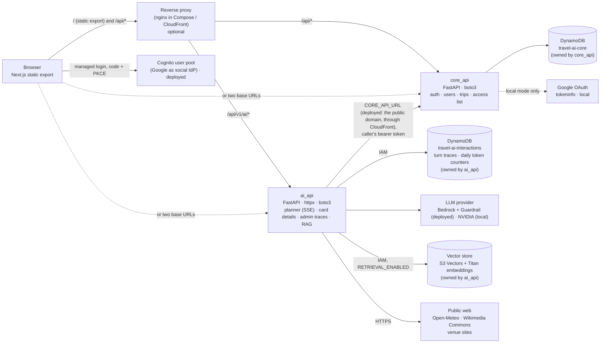
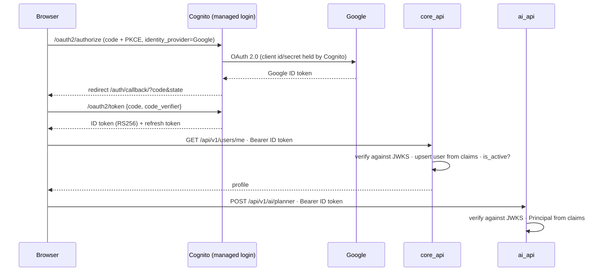
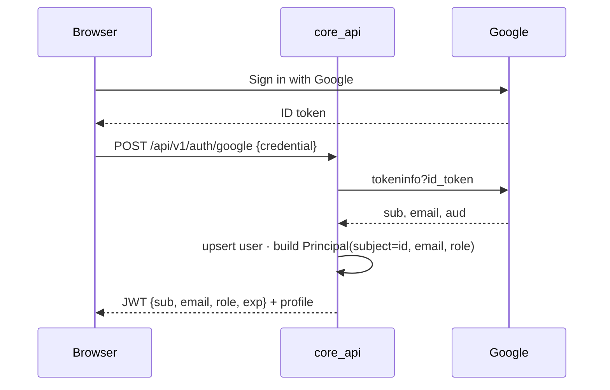
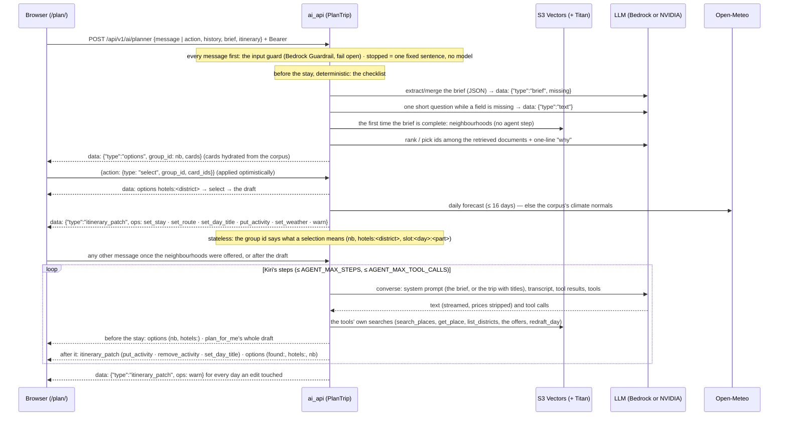
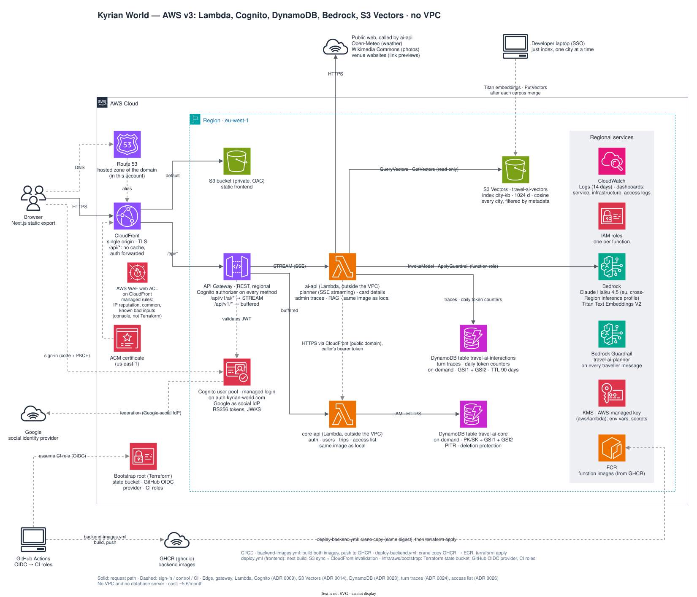
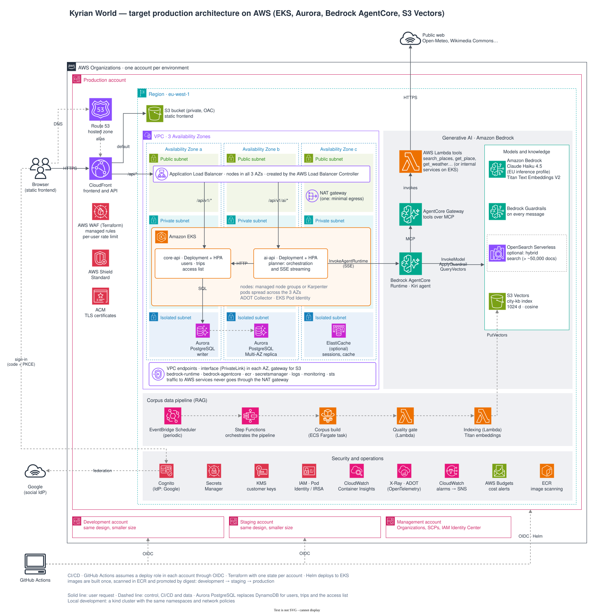

# Architecture overview

Kyrian World is a static Next.js frontend and two FastAPI services that share nothing at
runtime except the way they verify bearer tokens. See [ADR 0001](adr/0001-backend-split.md) for why.

## Containers

| Component | Owns | Never touches |
|---|---|---|
| `core_api` | users, trips and their children; account upsert and revocation; local-mode sign-in and token issuing | LLM providers |
| `ai_api` | prompts, providers, retrieval, streaming | `core_api`'s table and entities |
| `travel_common` | `Principal`, settings base, domain errors, token verification (local HS256, Cognito RS256), app factory | anything used by one service only |

Calls go in one direction only: `ai_api → core_api`. `core_api` works with `ai_api` down.

`core_api` keeps everything in **one DynamoDB table** ([ADR 0023](adr/0023-dynamodb-data-store.md)):
the account under `USER#<id>`/`PROFILE` (plus an `EMAIL#` item for uniqueness) and each trip as
one item holding its whole aggregate. The conversations of the retired chat (`THREAD#`/`MSG#`
items) remain in the table and nothing reads them ([ADR 0027](adr/0027-retire-chat-v1.md)).
There are no migrations and no SQL database.

## Code layout per service

- `core_api` is **layered**: `api → services → domain` (plain dataclasses and repository
  protocols), with `infrastructure/dynamo/` as the only storage adapter. Endpoints are thin;
  services raise domain errors; a single handler maps them to HTTP. `Trip` is the aggregate root: its children are nested under `/trips/{trip_id}/...` and
  authorised once at the boundary ([ADR 0005](adr/0005-trip-aggregate-nested-resources.md)). One
  trip is one city; its `phase` (`upcoming | ongoing | past`) is derived from its dates, and an
  ongoing or past trip refuses every write with 409 `TRIP_LOCKED`
  ([ADR 0019](adr/0019-trips-live-in-the-planner.md)).
  Domain models own their invariants (`check_invariants()`); profile and trip writes are
  conditional on a `version`, and a lost race is 409 `CONFLICT`.
- `ai_api` is **ports and adapters**: `domain` (types + Protocols) ← `application` (use cases) ←
  `infrastructure` (NVIDIA and Bedrock providers, Titan embedder, S3 Vectors retriever, trace log,
  Open-Meteo, Commons photos, site previews, SSE, core_api client) ← `api` (wiring). Swapping the
  LLM provider or
  adding a retriever touches only `infrastructure/` and `api/deps.py`.

Two styles on purpose: a CRUD service is best served by layers; an integration-heavy service by
ports. Each service's `AGENTS.md` documents its own.

## Identity

Two token issuers, one contract, selected by `AUTH_MODE` in both services
([ADR 0009](adr/0009-lambda-cognito-budget.md)): `travel_common.security.verify_token` yields
`Claims(subject, email, role, name, picture)`, endpoints see a `Principal(subject, email, role)`,
and `core_api` extends it with the account id (`AccountPrincipal`) after its database check.

**Deployed (`AUTH_MODE=cognito`).** The Amazon Cognito user pool signs people in with Google and
issues RS256 ID tokens; the services verify them offline against the pool's JWKS, which Terraform
passes as configuration. No token is issued by our code and no secret is shared between services.

**Local (`AUTH_MODE=local`, the default).** The Google Identity Services button gives the browser
a Google ID token; `core_api` verifies it with Google's `tokeninfo`, upserts the account and issues
its own HS256 token with `SECRET_KEY`, shared with `ai_api`.

**Where signing in lands.** The dialog and the Cognito callback both honour an explicit
destination — the landing's own `/plan/?q=<ask>`, or the path the route guard remembered in
`?redirect=` — and default to `/dashboard/`, the signed-in home: the ask that starts the next trip
over the cards of the ones already saved ([ADR 0020](adr/0020-signed-in-home-is-the-trips-page.md)).
A card opens `/plan/?trip=<id>`, read-only when its phase is not `upcoming`
([ADR 0019](adr/0019-trips-live-in-the-planner.md)).

In both modes:

- `core_api` verifies the token **and** checks the account in its table on every request:
  a deactivated user is cut off immediately. In Cognito mode the profile is upserted from the
  claims (written only when they change it) and the `admin` role mirrors the pool's `admin`
  group; in local mode the table owns the role (`PATCH /users/{id}/role`, mounted only in that
  mode).
- Administrators read every trip and account under `core_api`'s `/api/v1/admin` (GSI2 lists
  every trip newest first; each read logs an audit line). The Cognito `admin` group is filled from
  `admin_usernames` in Terraform (ADR 0024).
- **Signing in is not getting in** ([ADR 0026](adr/0026-access-list-and-daily-token-quota.md)).
  With `ACCESS_MODE=allowlist` (AWS) `core_api` lets an account through only when it is an
  administrator or its email is on the access list, which administrators edit at `/admin/access/`;
  everyone else gets 403 `ACCESS_DENIED` from every route except `GET /users/me` and
  `GET /users/me/access`. The frontend asks the latter once per signed-in account and shows a
  "not invited yet" page instead of the app. The same answer carries the account's daily token
  limit. `ai_api` honours both: before a planner request it asks `core_api` for that same
  answer with the caller's token (kept per account for 60 s), refuses an account that is not
  allowed (403 `ACCESS_DENIED`) and one that has spent its tokens of the UTC day (429
  `DAILY_TOKEN_LIMIT`, counted in its own table). Locally the mode is `open` and `ai_api` asks
  nobody (`ACCESS_CONTROL_ENABLED=false`); Compose and AWS turn the check on.
- `ai_api` keeps no accounts: it verifies the token itself and asks `core_api` only for access and
  the limit, above. A deactivated user can keep using the planner until the
  token expires (60 min). See [ADR 0002](adr/0002-auth-between-services.md) (superseded for the
  issuer, the rule for the boundary).

## Planner

The planner page (`/plan/`) talks to `POST /api/v1/ai/planner`, a typed stream: SSE v2
([ADR 0015](adr/0015-planner-sse-v2-stateless-orchestration.md)), one JSON event per
`data:` line (`text`, `brief`, `options`, `itinerary_patch`, `progress` ([ADR 0025](adr/0025-planner-progress-event.md)),
`error`, `done`) then `[DONE]`, with the models
generated for both sides by `just contracts`.

Kiri, one tool-using agent ([ADR 0032](adr/0032-kiri-is-a-tool-using-agent.md),
`ai_api/application/agent/`), runs the conversation. What stays deterministic: the brief's
extraction and its one question at a time, the first offer of the neighbourhoods, the page's own
"Generate the trip" and "Alternatives for day N · part" asks, and the `select` / `remove` actions.
Before the stay the model chooses among reading the guide, offering the neighbourhoods or the
hotels again, and `plan_for_me` when the traveller delegates the choice; after the draft
it searches, reads a place, the weather, checks a day, adds, removes, moves, retitles or redrafts a
day, and offers cards or other stays. The write tools accept only ids the server fetched
in that turn, so the guarantee below holds. A model that cannot call tools answers a fixed
sentence; there is no other fallback, and rolling back is redeploying the previous image.
Before any of it, every traveller message goes through the input guard: an Amazon
Bedrock Guardrail (`infra/aws/guardrail.tf`: prompt attacks, harmful content, card numbers, asks
unrelated to travel) that answers a stopped message with one fixed sentence and fails open; guide
text reaches the model only as `untrusted_text`, which its prompt treats as data.

The turn's trace (its model calls, retrievals with their top-k, tools, the SSE timeline) is
written to `<prefix>-interactions` before `[DONE]`, keyed by the page's `session_id` (ADR 0024).
An administrator reads it back through `GET /api/v1/ai/admin/{turns,turns/<id>,sessions/<id>,stats,usage}`
(403 for anyone else, one `admin_read` audit line per read), straight from that table.
`POST /api/v1/ai/admin/retrieval-eval` runs the retrieval evaluation against the index (nothing stored).

A card the page holds is an id, so opening one asks the service for it again: `GET
/api/v1/ai/planner/card?id=<doc id>` answers a `CardDetail` — the card's own fields plus the
corpus document's text, its address, phone and site (`application/card_detail.py`). Nothing is
taken from the client: an id the index does not hold is a 404. The lookup pictures that card the
way the carousel's are (Commons, then the venue's own site preview), but it cannot know the `why`
the model wrote for a turn, nor the fallback photo that turn picked, so the page merges the detail
onto the card it already holds rather than replacing it.

Retrieval ([ADR 0014](adr/0014-vector-store-s3-vectors.md)) searches an S3 Vectors index that is
filled out of band by `just index` from the corpus committed under `tools/city_corpus/data/`. The
wire format is framed by `ai_api/infrastructure/sse.py` and read by
`src/frontend/src/services/planner.ts`. `ai_api` never reaches `core_api`'s table: its only storage
is its own trace table, `<prefix>-interactions` ([ADR 0024](adr/0024-turn-traces-and-admin-access.md)),
which also holds each account's daily token counter
([ADR 0026](adr/0026-access-list-and-daily-token-quota.md)).

Every card is a retrieved corpus document (`application/cards.py`); ids the model returns that were
not retrieved are dropped, prices are tiers, flights a prefilled search link (`static_flight_search.py`),
and `application/validate.py` adds `warn` ops (distance, load per pace, closed that weekday, a price
in model text). Without the route (a 404) or without an `ai_api` URL the page plays the recorded
session in `src/frontend/src/data/planner-demo/session.ts` behind a demo banner; the same
session is the test double for the page.

## Service-to-service calls

When `ai_api` needs `core_api` (the caller's access; the planner's itinerary is saved by the
browser, not by `ai_api`), it calls `core_api` **as the user**:
it forwards the same bearer token, so `core_api` applies the same permissions it applies to the
browser. There is no service secret: an `INTERNAL_API_KEY` + `/internal/*` router belongs only to
a job that must act without a user.

| Call | When | What for |
|---|---|---|
| `GET /users/me/access` | before a planner request, and for the planner's reads, when `ACCESS_CONTROL_ENABLED` | may this account use the app, and its daily token limit ([ADR 0026](adr/0026-access-list-and-daily-token-quota.md)). Kept in process per token subject for `ACCESS_CACHE_SECONDS` (60); **fails closed**: when `core_api` cannot be asked the request is refused with 503 |

## Contracts

Pydantic schemas are the source of truth. `just contracts` exports `docs/api/*.openapi.json` and
regenerates `src/frontend/src/types/generated/*.ts`; CI fails on drift.

## Deployment shapes

| Environment | Origin(s) | Frontend env |
|---|---|---|
| Local `just dev-*` | `:8000` core, `:8001` ai | `NEXT_PUBLIC_API_URL`, `NEXT_PUBLIC_AI_API_URL` |
| Docker Compose (`just stack-up`) | nginx `:8080`: the export at `/`, the APIs at `/api/*` (same origin, like AWS) | `NEXT_PUBLIC_API_URL=http://localhost:8080` only, set by the recipe |
| AWS v3 (CloudFront → S3 + API Gateway → Lambda, `infra/aws/`) | one CloudFront domain | `NEXT_PUBLIC_API_URL=https://<domain>` (same origin) + `NEXT_PUBLIC_COGNITO_*` |

See [ADR 0003](adr/0003-frontend-two-base-urls.md) and the [deploy runbook](../runbooks/deploy.md).

### AWS as deployed (v3)

[`aws-architecture.drawio.svg`](aws-architecture.drawio.svg) is a draw.io diagram (official
"AWS Architecture" shape library) saved as an SVG with the diagram XML embedded: GitHub renders
it as is, and it is edited in place with the VS Code draw.io extension (installed by the
devcontainer) or at app.diagrams.net (File → Open). No build step. Decisions, cost estimate and
the order of work: [ADR 0009](adr/0009-lambda-cognito-budget.md) (Lambda, Cognito, no NAT; the
edge and gateway decisions come from [ADR 0008](adr/0008-aws-architecture-v2-edge-and-gateway.md)).
`infra/aws/` is this shape ([README](../../infra/aws/README.md)), with the planner on Bedrock
(`LLM_PROVIDER`: Claude Haiku 4.5 through an EU cross-Region inference profile, every traveller
message checked first by a Bedrock Guardrail) and the vector store on **Amazon S3 Vectors**
([ADR 0014](adr/0014-vector-store-s3-vectors.md)): a `pgvector` database inside a VPC could not be
reached from `ai_api`, which runs outside any VPC, and S3 Vectors needs no endpoint of its own. The
[vector store spike](vector-store-spike.md) measured Qdrant against it and kept S3 Vectors.

`core_api` stores its data in the DynamoDB
table `travel-ai-core` (on-demand, `PK`/`SK` + `GSI1` + `GSI2`, point-in-time recovery, deletion
protection; [ADR 0023](adr/0023-dynamodb-data-store.md)). Like `ai_api`, the function runs outside any VPC and reaches the table over
DynamoDB's public HTTPS endpoint, authorised by its IAM role. `ai_api` writes its turn traces and
the daily token counters to its own table, `travel-ai-interactions` (on-demand, `GSI1` + `GSI2`,
items expire after 90 days; [ADR 0024](adr/0024-turn-traces-and-admin-access.md)), and reaches
`core_api` through the public domain, so through CloudFront and the gateway like the browser.
There is no VPC in the account's shape. Images are built once by GitHub Actions and pushed to
GHCR; the backend deploy copies them to ECR with `crane` and runs `terraform apply`, and the
frontend deploy syncs the export to S3 and invalidates CloudFront. CloudFront
has a **WAF web ACL** (AWS managed rules: IP reputation, common rule set, known bad inputs),
created from the console and not managed by Terraform.

### Target production architecture

[`aws-target-architecture.drawio.svg`](aws-target-architecture.drawio.svg) (draw.io, edited like
the diagram above) is a **target design, not deployed**: the shape the platform would take for
production traffic. What changes, and why:

- **EKS in private subnets behind an ALB** replaces Lambda and the Lambda Web Adapter: no cold
  starts on the streaming planner, and scaling by replicas (HPA, pods spread across three
  Availability Zones); VPC endpoints keep AWS traffic off the single NAT gateway.
- **Aurora PostgreSQL** in isolated subnets replaces DynamoDB for users, trips and the access list,
  so reporting can use relational queries.
- **The agent runs in Bedrock AgentCore Runtime**; its tools are exposed over MCP through
  AgentCore Gateway. `ai-api` keeps orchestration and SSE streaming.
- **One AWS account per environment** (development, staging, production): images are built once,
  scanned in ECR and promoted by digest; GitHub Actions deploys with OIDC, Terraform and Helm.
- **Locally, a kind cluster** mirrors the namespaces and network policies.

The trade-off is cost: roughly 560 USD/month of fixed list-price cost in production, against
about 5 €/month for the current design. For demo traffic the serverless shape above stays the
right one.

## Known gaps

- No request rate limiting: the daily token quota ([ADR 0026](adr/0026-access-list-and-daily-token-quota.md))
  caps each account's model spend, not bursts of requests.
